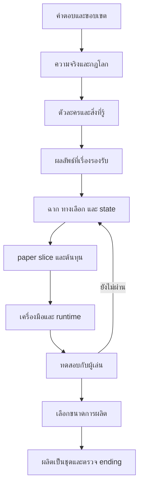

# 01 — แผนงานตั้งแต่ตัดสินใจจนส่งมอบ

**รอบปัจจุบัน: เอกสารเท่านั้น** งานหลัง P09 เป็นแผนสำหรับอนาคต ไม่ได้อนุญาตให้เริ่ม implementation ตอนนี้ ข้อเสนอที่ยังไม่ยืนยันดู [00](00_PROJECT_STATUS.md); คำถามทั้งหมดอยู่ [02](02_OPEN_QUESTIONS.md)

## 1. เป้าหมายที่ต้องพิสูจน์ก่อนขยาย

1. คนเล่นสนใจปริศนาและคนในเรื่องโดยไม่ต้องอ่านสารานุกรมโลก
2. การเลือกทำให้ได้เหตุการณ์/หลักฐาน/พันธมิตรต่างกันจริง และผลยังอยู่หลังกลับมารวมเส้น
3. ความจริงและแรงจูงใจอธิบายเบาะแสได้โดยไม่เปลี่ยนกฎย้อนหลัง
4. ความสัมพันธ์ ทีม สถานะ และ Level มีผลต่อวิธีทำสิ่งต่าง ๆ แต่ไม่ทำให้ต้อง grind เพื่ออ่านเรื่อง
5. คน/เวลาที่มีผลิตและตรวจเนื้อหาได้จริง ภาษาไทยและระบบ save ใช้งานบนเป้าหมายแรกได้

ข้อ 1–4 ตรวจเชิงเอกสารและ paper playtest ได้ก่อนแตะ engine; ข้อ 5 ด้าน runtime ต้องรอคำสั่ง implementation และการทดสอบจริง

## 2. ช่วงงานและ gate

| Gate | สิ่งที่ต้องมีจึงผ่าน | สิ่งที่ยังไม่หมายถึง |
|---|---|---|
| G0 แผนพร้อม review | audit + requirements + questions + tasks + S0 + validation ครบ เชื่อมกันได้ | ไม่ใช่อนุมัติ S0 หรืออนุญาต code |
| G1 แกนเรื่องตกลงแล้ว | P01/P02/P03/P04; Q01–Q06/Q08 มีคำตอบหรือผู้ใช้มอบหมายให้เลือกชัดเจน; Q07/Q21 มีค่าใช้ทำงานที่บันทึกไว้ | ไม่ล็อกบทพูด/ภาพ/engine ทั้งเกม |
| G2 paper slice พร้อมทดลองผลิต | P05/P06/P07/P08/P09; เดินทุก route บนกระดาษแล้วไม่ตัน; มีแพลตฟอร์ม ภาษา engine candidate และขอบเขต spike; ระบุ capacity/budget แม้บางช่อง UNKNOWN | ถ้า capacity UNKNOWN ห้ามสัญญากำหนดส่งเกมเต็ม |
| G3 เครื่องมือพิสูจน์แล้ว | P10 ผ่านภาษาไทย, input, save/load/rollback, restart และ export บนเป้าหมายแรก | ไม่แปลว่าเกมสนุก หรือรองรับทุก OS |
| G4 slice ผ่านเชิงประสบการณ์ | P11–P15; state/route tests ผ่าน ไม่มี blocker; playtest ได้หลักฐานเรื่อง agency/fairness/อ่านรู้เรื่อง | ไม่รับรองขนาด 12 บท |
| G5 ขอบเขตผลิตอนุมัติ | P16/P17/P18; ปริมาณเนื้อหา/asset/QA + capacity + ending coverage + release target สอดคล้องกัน | ไม่อนุมัติเพิ่ม feature ระหว่างผลิตโดยไม่ชั่งต้นทุน |
| G6 พร้อมเผยแพร่ | P19–P21; full-route QA, content warning, สิทธิ์ assets, save policy, เป้าหมายอุปกรณ์และแพ็กเกจที่ตรวจได้ผ่าน | การเผยแพร่ใน P22 ยังต้องมีคำสั่งเจ้าของที่ครอบคลุม ไม่อ้างว่าจำหน่ายแล้วเพียงเพราะ build สำเร็จ |

G0 คือสิ่งที่ชุดนี้เตรียมไว้ ยังไม่มี G1–G6 ผ่าน การยืนยันของเจ้าของอาจอยู่ในคำตอบแชต ไม่จำเป็นต้องสร้างเอกสารอนุมัติซ้ำ

## 3. Dependency ที่สำคัญ

เอกสาร UI/engine และ asset estimate ร่างเคียงกับ E ได้ ไม่ต้องรอเขียนบทครบ แต่ผลตัดสินต้องตรง Q09–Q24

## 4. Backlog ที่ให้โมเดลอื่นรับไปทีละงาน

สถานะ `DRAFT` = มีฐานร่างในชุดนี้แต่ยังไม่ผ่าน gate; `NEXT` = งานถัดไป; `FUTURE` = ยังไม่เริ่ม

| ID / สถานะ | งานและ dependency | ผลส่งมอบ / เกณฑ์จบ | ขอบเขต |
|---|---|---|---|
| P00 DONE | ตรวจ brief/repo | provenance, R01–R12, F01–F10 ใน 00; เก็บต้นฉบับ | docs |
| P01 PARTIAL | รับคำตอบ 02 | Q01–Q07 บันทึกแล้ว; ปิดรอบแกนเมื่อ Q08 ตอบ; decision ทุกข้อมีสถานะ; ไม่ถามสิ่งที่ตอบแล้ว | docs |
| P02 DRAFT | premise + truth/rules; หลัง P01 ที่เกี่ยวข้อง | เลือก/แก้ S0 ใน 03; timeline แสดงใครทำอะไร ทำไม ทำได้อย่างไร ทิ้งร่องรอยอะไร | docs |
| P03 DRAFT | character/knowledge bible; หลัง P02 | ทุกตัวละครมีเป้าหมาย ข้อเชื่อผิด ความลับ ราคาที่รับได้ และเงื่อนไขเปลี่ยนฝ่าย; ไม่มีผู้รู้ทุกอย่าง | docs |
| P04 DRAFT | ending contract; หลัง P02/P03 | แยกอดีตจริงกับผลปัจจุบัน; ผลลัพธ์แต่ละกลุ่มมี prerequisites, clues, costs และ fallback | docs |
| P05 DRAFT | branch/scene graph; หลัง P02/P03/P04 | scene/choice/evidence IDs ครบ มี exclusive events + merge consequences; ไม่มีทางตัน | docs |
| P06 DRAFT | state/Level/team contract; หลัง P05 | type/default/read/write/scope/invariants/save policy ตรงกัน; ทุก state มีผู้ใช้จริง | docs |
| P07 FUTURE | เขียนบทเฉพาะ slice ที่ยืนยันแล้ว; หลัง P05/P06/P04 | script 12 nodes หรือจำนวนแก้ล่าสุด + inline variants; paper walkthrough บันทึกเหตุผลแต่ละ choice; ไม่เขียนเต็ม 12 บท | narrative docs; ไม่ทำในรอบนี้ |
| P08 DRAFT | UX + engine decision brief; หลัง Q09–Q16/Q23/Q24 | จอหลัก input/Thai/accessibility/save behavior, engine candidate และ spike acceptance ใน 05/06 | docs |
| P09 DRAFT | ต้นทุน slice; หลัง P05/P06 และ Q17–Q20 | asset inventory, คนทำ, เวลาที่มี, estimate ranges/UNKNOWN; กำหนดเพดานทดลอง | docs |
| P10 FUTURE | technical spike; หลัง G2 + คำสั่งให้เขียนโค้ด | หนึ่งฉาก ภาษาไทย choices journal save/load rollback; export เป้าหมายแรก; บันทึก engine/version และผลจริง | code ในอนาคต |
| P11 FUTURE | text-only slice; หลัง G3/P07 | เดิน routes ตาม 04; choices เปลี่ยน state เท่านั้นผ่านจุดที่กำหนด; มี debug trace | code ในอนาคต |
| P12 FUTURE | UI + ภาพ/เสียงชุดเล็ก; หลัง P11/P09 | ใช้ asset IDs/licences; เปลี่ยน text size/input/ลดเอฟเฟกต์ได้; ข้อมูลจากเสียงอ่านเป็นข้อความได้ | code/assets ในอนาคต |
| P13 FUTURE | verification; หลัง P11/P12 | ตรวจ route/state/save/Thai ตาม 06; ไม่ test เฉพาะ happy path | tests ในอนาคต |
| P14 FUTURE | playtest slice; หลัง P13 ไม่มี blocker | ผู้เล่น 3–5 คนตามเกณฑ์ 06; เวลาอ่าน/การเลือก/จุดสับสนและคำเล่าเหตุผลเป็นหลักฐาน | playtest ในอนาคต |
| P15 FUTURE | แก้จาก playtest; หลัง P14 | แก้ blocker/ความไม่ยุติธรรม แล้วทดสอบเฉพาะจุดที่เปลี่ยน; สรุปผ่าน G4 หรือกลับ P05/P07 | ตามปัญหาจริง |
| P16 FUTURE | calibrate ต้นทุนเต็มเกม; หลัง G4 | ต้นทุนจริงต่อฉาก/variant/asset/QA + throughput; เปรียบเทียบ 3–4/6–8/12 บท | docs |
| P17 FUTURE | เลือก scope/release; หลัง P16 + Q17/Q18/Q25–Q27 | เจ้าของเลือกจำนวนบท route/ending budget และสิ่งตัด; capacity รองรับ; ยังไม่เผยแพร่ | docs |
| P18 FUTURE | full beat/route/production plan; หลัง P17 | ขยายหน้าที่เรื่องใน 03 ตามขนาดที่เลือก; ทุก reveal/ending มี clue path; backlog ต่อบทและ asset reuse | docs |
| P19 FUTURE | ผลิตทีละชุดหลัง G5 | เริ่มบทแรก → บทถัดไป; แต่ละชุดเล่นได้ ตรวจ continuity/state/save และปรับต้นทุนจริง | code/story/assets |
| P20 FUTURE | content complete / localization ที่เลือก | ทุก route และ ending ที่ตกลงมีเนื้อหาครบ; no placeholders; แปลตาม text IDs เมื่ออยู่ใน scope | content |
| P21 FUTURE | release QA + แพ็กเกจพร้อม review | ตรวจ full routes, save upgrade, platform/accessibility; build ที่ติดตั้งใหม่ได้ พร้อมคู่มือ/เครดิต/คำเตือน/changelog ตาม 06 | tests/build/docs |
| P22 FUTURE | distribution หลัง G6 | เผยแพร่แพ็กเกจที่ตรวจใน P21 เฉพาะเมื่อมีคำสั่งครอบคลุม; บันทึก release/version และช่องทางรับปัญหา | release |

เลข task เป็นตัวระบุคงที่; ลำดับหลักเรียงจาก P00 ถึง P22 แต่เริ่มงานได้เมื่อ dependency และ gate ของงานนั้นพร้อม ไม่ถือว่าทำงานก่อนหน้าหนึ่งชิ้นแล้วผ่าน gate ทั้งชุด

## 5. แพ็กเกจงานถัดไปที่ให้โมเดลขนาดเล็กทำได้

### P01: สรุปคำตอบหนึ่งรอบ

Input: 00/02 + คำตอบเจ้าของ → Output: answer log และ decision table ที่ซิงก์ → Done: ไม่คง `UNANSWERED` ในข้อที่ตอบจริงและไม่ยืนยันส่วนที่ยังไม่ได้ตอบ. ณ 2026-10-14 Q01–Q07 เสร็จ; Q08 เป็นคำถามถัดไปของ P01.

ถ้ายังไม่มีคำตอบ: จัดลำดับคำถามตาม gate/ผลกระทบได้ ตรวจ S0 ต่อได้ ห้ามตอบแทนเจ้าของ

### P02: ล็อกกฎเรื่องโดยไม่เริ่มบทเต็ม

Input: D01–D04 ที่ตกลง + 03 → Output: premise หนึ่งย่อหน้า, truth/timeline/rule ledger ที่ขัดกันเป็นศูนย์, ตัวเลือกที่ถูกเลิกใช้พร้อมเหตุผล → Done: แต่ละเฉลยใช้กฎที่ปูไว้และมีหลักฐานที่ไม่ใช่คำพูดคนเดียว

### P05/P06: ตรวจ branch กับ state

Input: truth/character/ending ที่อนุมัติ + 04 → Output: graph/edges/state/choice consequences ที่ตรงกัน → Done: นับ trace ใหม่ได้ ทุก scene/ending reachable, ไม่มี state ที่อ่านแต่ไม่เคยเขียน

ถ้าเปลี่ยนทางเลือก ต้องตรวจ 06 และ asset budget 05 ด้วย อย่าเพิ่มตัวเลขความสัมพันธ์เพียงเพื่อเลี่ยงแก้แรงจูงใจ

## 6. สิ่งที่เดินต่อได้ระหว่างรอคำตอบ

| สิ่งที่ยังไม่รู้ | งานที่ทำต่อได้ | สิ่งที่ต้องคงว่าไม่สรุป |
|---|---|---|
| Q01–Q06 | ตรวจตรรกะ S0, เปรียบเทียบ trade-offs, ทำ generic contracts | canon, ผู้ร้าย, romance, deaths |
| Q09/Q10 | ออกแบบจอ/state แบบไม่ขึ้นกับ engine, ทวน official docs | exporter, mobile support, engine lock |
| Q17/Q18 | นับฉาก/asset/variant, ทำสูตร capacity | วันเสร็จ งบรวม จำนวนคน |
| Q19/Q20 | asset IDs, reuse plan, requirements | final style, AI permission, สัญญาจ้าง |
| Q25–Q28 | core design และ slice ในขอบเขตที่ตกลง | store/ราคา/ชื่อขาย/การเผยแพร่สปอยล์ canon |

## 7. เพดานและการจัดการการเปลี่ยนแผน

- S0: 12 scene nodes, 4 choices (1 utility + 3 major), 2 investigation routes, 3 checkpoints; no combat, no live AI, no full voice acting เป็น **ขอบเขตเสนอ**
- ถ้าขอเพิ่มระบบ ให้ระบุ requirement ที่ตอบโจทย์, scene ที่ใช้, states/branches/assets ที่เพิ่ม, QA ที่เพิ่ม และสิ่งที่จะลดหรือเลื่อน
- ถ้า Q01 เปลี่ยนเป็น loop: หยุดใช้ S0 เป็น executable spec แล้วออกแบบ timeline/meta-state ก่อน ไม่ซ้อน loop ทับ flags เดิม
- ถ้า Q09 เป็น mobile/web: เปลี่ยน P08/P10 เป็น mobile-first verification ก่อนเลือก engine ไม่ทำ desktop ทั้งชุดแล้วค่อยหดจอ
- ถ้า playtest ไม่เห็นผลของ choice: แก้ event/payoff ก่อนเพิ่มภาพหรือบทใหม่
- ถ้าผลิตช้า: ลด cast/locations/CG/ความยาวตามลำดับที่เจ้าของเลือก รักษา causal choice กับคำตอบปริศนา ไม่ตัดบทกลางจนเหตุผลหาย
- การปิด task ใช้หลักฐานในไฟล์/PR; การมีเอกสารชื่อ “plan” ไม่ได้ทำให้ task ที่บรรยายในนั้นเสร็จแล้ว

## 8. Definition of done สำหรับรอบปัจจุบัน

- [x] ตรวจ repository และอ่าน brief ครบ แยก confirmed/proposed/open
- [x] ครอบคลุมคำถามเดิม 5 หมวดและเพิ่มปัญหาที่มีผลต่อการผลิต
- [x] มี conditional blueprint, slice/state, production/tech และ validation/risk plan
- [x] มี dependencies, gate, task IDs, acceptance และ handoff ที่เริ่มได้ทันที
- [ ] เจ้าของตอบคำถาม/ยืนยัน S0 — เป็นงานถัดไป ไม่ใช่งานที่อ้างว่าจบในรอบนี้
- [ ] เขียนเกม/ทดสอบเกม — ยังไม่อยู่ในขอบเขตรอบนี้
