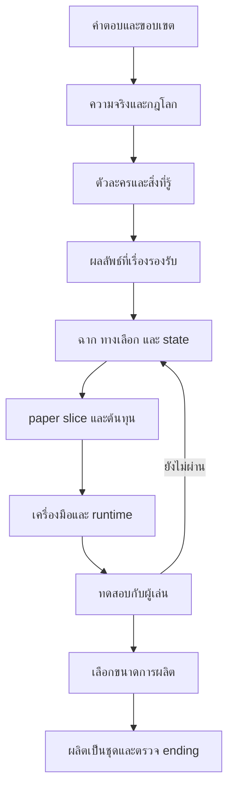

# 01 — แผนงานตั้งแต่ตัดสินใจจนส่งมอบ

**ล่าสุด2026-10-21 — [คำตอบโครงผู้นำ](questions/topics/10_faction_leadership_03.md):** Q926–Q941รับครบแล้ว: Q927=A+B+Cผู้อำนวยการมีทั้งความเชื่อความมั่นคง ความทะเยอทะยาน และแรงรักษาตัวเอง; Q928=Cผู้อนุมัติสูงเป็นคนสั่งเร่งและยอมสูญเสีย; Q932=A+Bผู้นำองค์กรสร้างฐานอำนาจและต้องการโค่นฝ่ายรัฐขึ้นควบคุมแทน. ข้ออื่นตามคำแนะนำ รวมQ939=Cเลื่อนวิธีจบ ไม่ล็อกฆ่าหรือจับ; Q941=Aผลเครือข่ายขึ้นกับสิ่งที่ทีมตัดไปก่อน. Q942เป็นเลขถัดไป ยังไม่ได้สร้างคำถาม. P02ยังIN PROGRESS; โครงมาก่อนประวัติ Q839–Q862ยังพัก.

**อัปเดต Q902–Q925 — 2026-10-21:** รับ24คำตอบแล้ว แยกเจ้าของเป็น[กฎเทค](questions/topics/13_enhancement_skill_transfer_02.md)และ[รัฐ/องค์กร](questions/topics/10_state_criminal_conflict_02.md). Q905สกัดแล้วเจ้าของเสียทักษะนั้นทั้งหมด สมองเสียหาย/คิดผิดเพี้ยน/ตายได้; Q908คนทั่วไปไม่รู้การถ่ายทอด; Q918รัฐจ้างองค์กรก่อนแตกหักเป็นศัตรู; Q922เน้นต่อสู้ตัดเครือข่ายและอาจฆ่าหัวหน้า ยังไม่ล็อกวิธีจบ; Q924ผู้ทดลองคนแรกตายแน่นอน; Q925=Cทำโครงผู้นำก่อนคดี. [Q926–Q941](questions/topics/10_faction_leadership_03.md)รับคำตอบแล้ว; Q939วิธีจบยังDEFERRED. P02 IN PROGRESS; Q839–Q862ยังพัก ไม่ทำประวัติ/ภาพ/code.

**ลำดับปัจจุบัน 2026-10-21:** Q901รับแกนใหม่แล้วตาม[ต้นทาง](questions/topics/01_main_plot_alternatives_02.md#q901). ทำP02กฎถ่ายทอดความสามารถ โครงความขัดแย้งรัฐ/องค์กร และคดีตาม[แกนปัจจุบัน](story/01_experimental_humans_factions.md)ก่อนP03ประวัติ. ไม่ถามเลือกแกนเดิมซ้ำ. Q902–Q925รับแล้ว; Q926–Q941โครงผู้นำรับแล้ว; Q942ยังไม่สร้าง. Q839–Q862ยังพัก.

**คำตอบล่าสุด:** ดู decision register ใน [00](00_PROJECT_STATUS.md) และ answer log Q01–Q116 ใน [02](02_OPEN_QUESTIONS.md).

## 1. เป้าหมายที่ต้องพิสูจน์ก่อนขยาย

1. คนเล่นสนใจปริศนาและคนในเรื่องโดยไม่ต้องอ่านสารานุกรมโลก
2. การเลือกทำให้ได้เหตุการณ์/หลักฐาน/พันธมิตรต่างกันจริง และผลยังอยู่หลังกลับมารวมเส้น
3. ความจริงและแรงจูงใจอธิบายเบาะแสได้โดยไม่เปลี่ยนกฎย้อนหลัง
4. ความสัมพันธ์ ทีม สถานะ และ Level มีผลต่อวิธีทำสิ่งต่าง ๆ แต่ไม่ทำให้ต้อง grind เพื่ออ่านเรื่อง
5. คน/เวลาที่มีผลิตและตรวจเนื้อหาได้จริง ภาษาไทยและระบบ save ใช้งานบนเป้าหมายแรกได้

ข้อ 1–4 ตรวจเชิงเอกสารและ paper playtest ได้ก่อนแตะ engine; ข้อ 5 ด้าน runtime ต้องรอคำสั่ง implementation และการทดสอบจริง

## 2. ช่วงงานและ gate

| Gate | สิ่งที่ต้องมีจึงผ่าน | สิ่งที่ยังไม่หมายถึง |
|---|---|---|
| G0 แผนพร้อม review | audit + requirements + questions + tasks + S0 + validation ครบ เชื่อมกันได้ | ไม่ใช่อนุมัติ S0 หรืออนุญาต code |
| G1 แกนเรื่องตกลงแล้ว | P01/P02/P03/P04; Q01–Q06/Q08 มีคำตอบหรือผู้ใช้มอบหมายให้เลือกชัดเจน; Q07/Q21 มีค่าใช้ทำงานที่บันทึกไว้ | ไม่ล็อกบทพูด/ภาพ/engine ทั้งเกม |
| G2 paper slice พร้อมทดลองผลิต | P05/P06/P07/P08/P09; เดินทุก route บนกระดาษแล้วไม่ตัน; มีแพลตฟอร์ม ภาษา engine candidate และขอบเขต spike; ระบุ capacity/budget แม้บางช่อง UNKNOWN | ถ้า capacity UNKNOWN ห้ามสัญญากำหนดส่งเกมเต็ม |
| G3 เครื่องมือพิสูจน์แล้ว | P10 ผ่านภาษาไทย, input, save/load/rollback, restart และ export บนเป้าหมายแรก | ไม่แปลว่าเกมสนุก หรือรองรับทุก OS |
| G4 slice ผ่านเชิงประสบการณ์ | P11–P15; state/route tests ผ่าน ไม่มี blocker; playtest ได้หลักฐานเรื่อง agency/fairness/อ่านรู้เรื่อง | ไม่รับรองขนาด 12 บท |
| G5 ขอบเขตผลิตอนุมัติ | P16/P17/P18; ตรวจ feasibility ของเป้า 12 บทและกำหนดปริมาณเนื้อหา/asset/QA + capacity + ending coverage + release target สอดคล้องกัน | ไม่อนุมัติเพิ่ม feature ระหว่างผลิตโดยไม่ชั่งต้นทุน |
| G6 พร้อมเผยแพร่ | P19–P21; full-route QA, content warning, สิทธิ์ assets, save policy, เป้าหมายอุปกรณ์และแพ็กเกจที่ตรวจได้ผ่าน | การเผยแพร่ใน P22 ยังต้องมีคำสั่งเจ้าของที่ครอบคลุม ไม่อ้างว่าจำหน่ายแล้วเพียงเพราะ build สำเร็จ |

G0 คือสิ่งที่ชุดนี้เตรียมไว้ ยังไม่มี G1–G6 ผ่าน การยืนยันของเจ้าของอาจอยู่ในคำตอบแชต ไม่จำเป็นต้องสร้างเอกสารอนุมัติซ้ำ

## 3. Dependency ที่สำคัญ

เอกสาร UI/engine และ asset estimate ร่างเคียงกับ E ได้ ไม่ต้องรอเขียนบทครบ แต่ผลตัดสินต้องตรง Q09–Q24

## 4. Backlog ที่ให้โมเดลอื่นรับไปทีละงาน

สถานะ `DRAFT` = มีฐานร่างแต่ยังไม่ผ่าน gate; `DRAFT REVIEW` = ร่างผลส่งมอบครบพร้อมตรวจ แต่ยังไม่ยืนยัน canon; `IN PROGRESS` = กำลังปรับตามคำตอบ; `NEXT` = งานถัดไป; `FUTURE` = ยังไม่เริ่ม

| ID / สถานะ | งานและ dependency | ผลส่งมอบ / เกณฑ์จบ | ขอบเขต |
|---|---|---|---|
| P00 DONE | ตรวจ brief/repo | provenance, R01–R12, F01–F10 ใน 00; เก็บต้นฉบับ | docs |
| P01 DONE | รับคำตอบ 02 | Q01–Q08 บันทึกแล้ว; decision ทุกข้อมีสถานะ; ไม่ถามสิ่งที่ตอบแล้ว | docs |
| P02 IN PROGRESS | แกนมนุษย์รุ่นทดลอง+ตลาดความสามารถรับแล้วตามQ901; หลังP01 | วางtruth/rulesใหม่: รัฐเจ้าของโครงการ องค์กรร้ายแย่งเทค; กำหนดคดี/หลักฐาน/จังหวะทีมก่อนประวัติ. แกนเก่า/4คดี/S0ไม่ผ่านโดยอัตโนมัติ | docs |
| P03 IN PROGRESS | character/knowledge bible; castรวมราว30 ทีมกรอบราว12 เส้นรัก4และนักสู้หลัก3; รอP02แกนใหม่ก่อนตรึงบทบาท/ประวัติ | ทุกตัวละครมีเป้าหมาย ข้อเชื่อผิด ความลับ ราคาที่รับได้ และเงื่อนไขเปลี่ยนฝ่าย; ไม่มีผู้รู้ทุกอย่าง | docs |
| P04 DRAFT | ending contract; หลัง P02/P03 | แยกอดีตจริงกับผลปัจจุบัน; ผลลัพธ์แต่ละกลุ่มมี prerequisites, clues, costs และ fallback | docs |
| P05 DRAFT | branch/scene graph; หลัง P02/P03/P04 | scene/choice/evidence IDs ครบ มี exclusive events + merge consequences; ไม่มีทางตัน | docs |
| P06 DRAFT | state/Level/team contract; หลัง P05 | type/default/read/write/scope/invariants/save policy ตรงกัน; ทุก state มีผู้ใช้จริง | docs |
| P07 FUTURE | เขียนบทเฉพาะ slice ที่ยืนยันแล้ว; หลัง P05/P06/P04 | script 12 nodes หรือจำนวนแก้ล่าสุด + inline variants; paper walkthrough บันทึกเหตุผลแต่ละ choice; ไม่เขียนเต็ม 12 บท | narrative docs; ไม่ทำในรอบนี้ |
| P08 DRAFT | UX + engine decision brief; หลัง Q09–Q16/Q23/Q24 | จอหลัก input/Thai/accessibility/save behavior, engine candidate และ spike acceptance ใน 05/06 | docs |
| P09 DRAFT | ต้นทุน slice; หลัง P05/P06 และ Q17–Q20 | asset inventory, คนทำ, เวลาที่มี, estimate ranges/UNKNOWN; กำหนดเพดานทดลอง | docs |
| P10 FUTURE | technical spike; หลัง G2 + คำสั่งให้เขียนโค้ด | หนึ่งฉาก ภาษาไทย choices journal save/load rollback; export เป้าหมายแรก; บันทึก engine/version และผลจริง | code ในอนาคต |
| P11 FUTURE | text-only slice; หลัง G3/P07 | เดิน routes ตาม 04; choices เปลี่ยน state เท่านั้นผ่านจุดที่กำหนด; มี debug trace | code ในอนาคต |
| P12 FUTURE | UI + ภาพ/เสียงชุดเล็ก; หลัง P11/P09 | ใช้ asset IDs/licences; เปลี่ยน text size/input/ลดเอฟเฟกต์ได้; ข้อมูลจากเสียงอ่านเป็นข้อความได้ | code/assets ในอนาคต |
| P13 FUTURE | verification; หลัง P11/P12 | ตรวจ route/state/save/Thai ตาม 06; ไม่ test เฉพาะ happy path | tests ในอนาคต |
| P14 FUTURE | playtest slice; หลัง P13 ไม่มี blocker | ผู้เล่น 3–5 คนตามเกณฑ์ 06; เวลาอ่าน/การเลือก/จุดสับสนและคำเล่าเหตุผลเป็นหลักฐาน | playtest ในอนาคต |
| P15 FUTURE | แก้จาก playtest; หลัง P14 | แก้ blocker/ความไม่ยุติธรรม แล้วทดสอบเฉพาะจุดที่เปลี่ยน; สรุปผ่าน G4 หรือกลับ P05/P07 | ตามปัญหาจริง |
| P16 FUTURE | calibrate ต้นทุนเต็มเกม; หลัง G4 | ต้นทุนจริงต่อฉาก/variant/asset/QA + throughput; ประเมินเป้า 12 บทแบบยืดหยุ่น | docs |
| P17 FUTURE | ตรวจ feasibility/scope/release; หลัง P16 + Q17/Q18/Q25–Q27 | ยืนยันว่าทรัพยากรรองรับเป้า 12 บทหรือเสนอการปรับที่เจ้าของอนุมัติ; กำหนด route/ending budget และสิ่งตัด; ยังไม่เผยแพร่ | docs |
| P18 FUTURE | full beat/route/production plan; หลัง P17 | ขยายหน้าที่เรื่องใน 03 ตามขนาดที่เลือก; ทุก reveal/ending มี clue path; backlog ต่อบทและ asset reuse | docs |
| P19 FUTURE | ผลิตทีละชุดหลัง G5 | เริ่มบทแรก → บทถัดไป; แต่ละชุดเล่นได้ ตรวจ continuity/state/save และปรับต้นทุนจริง | code/story/assets |
| P20 FUTURE | content complete / localization ที่เลือก | ทุก route และ ending ที่ตกลงมีเนื้อหาครบ; no placeholders; แปลตาม text IDs เมื่ออยู่ใน scope | content |
| P21 FUTURE | release QA + แพ็กเกจพร้อม review | ตรวจ full routes, save upgrade, platform/accessibility; build ที่ติดตั้งใหม่ได้ พร้อมคู่มือ/เครดิต/คำเตือน/changelog ตาม 06 | tests/build/docs |
| P22 FUTURE | distribution หลัง G6 | เผยแพร่แพ็กเกจที่ตรวจใน P21 เฉพาะเมื่อมีคำสั่งครอบคลุม; บันทึก release/version และช่องทางรับปัญหา | release |

เลข task เป็นตัวระบุคงที่; ลำดับหลักเรียงจาก P00 ถึง P22 แต่เริ่มงานได้เมื่อ dependency และ gate ของงานนั้นพร้อม ไม่ถือว่าทำงานก่อนหน้าหนึ่งชิ้นแล้วผ่าน gate ทั้งชุด

## 5. แพ็กเกจงานถัดไปที่ให้โมเดลขนาดเล็กทำได้

### P01: สรุปคำตอบหนึ่งรอบ

Input: 00/02 + คำตอบเจ้าของ → Output: answer log และ decision table ที่ซิงก์ → Done: ไม่คง `UNANSWERED` ในข้อที่ตอบจริงและไม่ยืนยันส่วนที่ยังไม่ได้ตอบ. ณ 2026-10-14 Q01–Q08 เสร็จ; Q21 ตอบแล้วเป็นตัวเอกผู้เขียนกำหนด; ข้อมูลกำลังผลิตยังรอตาม dependency.

ถ้ายังไม่มีคำตอบ: จัดลำดับคำถามตาม gate/ผลกระทบได้ ตรวจ S0 ต่อได้ ห้ามตอบแทนเจ้าของ

### P02: ล็อกกฎเรื่องโดยไม่เริ่มบทเต็ม

Input: D01–D04 + 03 → Output: premise, truth/timeline/rule ledger และสมมติฐานที่ยกเลิก → Done: แต่ละเฉลยใช้กฎที่ปูไว้และหลักฐานอิสระ. Q04.3 ปิดแล้ว: การทดลอง C00 ไม่เกี่ยวข้องกับสถาบัน/คดี; ห้ามนำงานไปใช้ต่อหรือสร้างเส้นเชื่อมทางอ้อม.

### P05/P06: ตรวจ branch กับ state

Input: truth/character/ending ที่อนุมัติ + 04 → Output: graph/edges/state/choice consequences ที่ตรงกัน → Done: นับ trace ใหม่ได้ ทุก scene/ending reachable, ไม่มี state ที่อ่านแต่ไม่เคยเขียน

ถ้าเปลี่ยนทางเลือก ต้องตรวจ 06 และ asset budget 05 ด้วย อย่าเพิ่มตัวเลขความสัมพันธ์เพียงเพื่อเลี่ยงแก้แรงจูงใจ

## 6. สิ่งที่เดินต่อได้ระหว่างรอคำตอบ

| สิ่งที่ยังไม่รู้ | งานที่ทำต่อได้ | สิ่งที่ต้องคงว่าไม่สรุป |
|---|---|---|
| Q01–Q08 | ปรับ premise ตามทิศทางที่ยืนยัน; ตรวจตรรกะ S0 แบบ PROPOSED | รายละเอียด canon, ผู้ร้าย, คู่รัก/จำนวน routes, deaths; ขนาด 12 บทยังไม่ใช่ commitment ต่อเวลา/งบ |
| Q09/Q10 | ออกแบบจอ/state แบบไม่ขึ้นกับ engine, ทวน official docs | exporter, mobile support, engine lock |
| Q17/Q18 | นับฉาก/asset/variant, ทำสูตร capacity | วันเสร็จ งบรวม จำนวนคน |
| Q19/Q20 | asset IDs, reuse plan, requirements | final style, AI permission, สัญญาจ้าง |
| Q25–Q28 | core design และ slice ในขอบเขตที่ตกลง | store/ราคา/ชื่อขาย/การเผยแพร่สปอยล์ canon |

## 7. เพดานและการจัดการการเปลี่ยนแผน

- S0: 12 scene nodes, 4 choices (1 utility + 3 major), 2 investigation routes, 3 checkpoints; no combat, no live AI, no full voice acting เป็น **ขอบเขตเสนอ**
- ถ้าขอเพิ่มระบบ ให้ระบุ requirement ที่ตอบโจทย์, scene ที่ใช้, states/branches/assets ที่เพิ่ม, QA ที่เพิ่ม และสิ่งที่จะลดหรือเลื่อน
- ถ้า Q01 เปลี่ยนเป็น loop: หยุดใช้ S0 เป็น executable spec แล้วออกแบบ timeline/meta-state ก่อน ไม่ซ้อน loop ทับ flags เดิม
- ถ้า Q09 เป็น mobile/web: เปลี่ยน P08/P10 เป็น mobile-first verification ก่อนเลือก engine ไม่ทำ desktop ทั้งชุดแล้วค่อยหดจอ
- ถ้า playtest ไม่เห็นผลของ choice: แก้ event/payoff ก่อนเพิ่มภาพหรือบทใหม่
- ถ้าผลิตช้า: ลด cast/locations/CG/ความยาวตามลำดับที่เจ้าของเลือก รักษา causal choice กับคำตอบปริศนา ไม่ตัดบทกลางจนเหตุผลหาย
- การปิด task ใช้หลักฐานในไฟล์/PR; การมีเอกสารชื่อ “plan” ไม่ได้ทำให้ task ที่บรรยายในนั้นเสร็จแล้ว

## 8. Definition of done สำหรับรอบปัจจุบัน

- [x] ตรวจ repository และอ่าน brief ครบ แยก confirmed/proposed/open
- [x] ครอบคลุมคำถามเดิม 5 หมวดและเพิ่มปัญหาที่มีผลต่อการผลิต
- [x] มี conditional blueprint, slice/state, production/tech และ validation/risk plan
- [x] มี dependencies, gate, task IDs, acceptance และ handoff ที่เริ่มได้ทันที
- [ ] เจ้าของตอบคำถาม/ยืนยัน S0 — เป็นงานถัดไป ไม่ใช่งานที่อ้างว่าจบในรอบนี้
- [ ] เขียนเกม/ทดสอบเกม — ยังไม่อยู่ในขอบเขตรอบนี้

**งานถัดไปหลัง Q65–Q96:** P03 เสนอ roster ส่งงานและบทบาทต่อสู้ (รวม30เท่าเดิม); P05/P06 ออกแบบ mission/timeline/knowledge/state contract ตาม 04 Dispatch contract. Windows+Linux เป็นเกณฑ์ P08/P10; Q83 ยืนยัน C แล้ว. ยังไม่เริ่ม code.

**Q83 ยืนยันล่าสุด 2026-10-14:** C เวลาตัวเลือกด่วนตายตัวตามฉาก ไม่เพิ่มเวลา/ปิด countdown; ระยะเวลารายฉากยังไม่ล็อก. ใช้แทนข้อความ Q83 OPEN ก่อนหน้า. Q82 หมดเวลาให้ตัวละครลงมือเองตามบุคลิกและความรู้จริง.

**ข้อกำหนดภารกิจ Q97–Q116:** ดู [04](04_SLICE_SPEC.md) และคำตอบต้นทางใน [02](02_OPEN_QUESTIONS.md).

**Q117–Q140 ล่าสุด:** บันทึกครบใน02; P03ประวัติเต็ม30คน/สมาชิกต่อสู้2แนว/อดีตฝ่ายร้าย/ขอบเขตศีลธรรมดู03; ทดลอง5คน สองแหล่งคดีเดียว ไม่มีสมาชิกตาย และรายงานขัดกันดู04. Q133สถานที่ยังมอบหมายให้เสนอ. UIสมุดคำสัญญา/รายงานความไม่แน่ใจไม่เปิดค่าลับ. Asset/graph/traceเดิมยังต้องทวน ไม่รับรองruntime. งานถัดไป P03 rosterและP05/P06 mission graph ตามเงื่อนไขใหม่.

**Q141–Q160 ล่าสุด:** บันทึกครบ02; รับร่างทีมทดลอง4ชื่อเดิม+ผู้คุ้มกันรู้จักมายา(ยังไม่ระบุคน), คู่สถานที่จุดรับบริการ/ศูนย์ขนส่งตาม04. Q158ไม่ลดความสัมพันธ์อัตโนมัติ ต้องมีการรับรู้และเหตุรองรับตาม03. Q159ฉากปิดคนสำคัญ/ผลคนรอง; Q160route mapหลังจบแสดงส่วนเคยเล่นพร้อมย้อนstate โดยไม่ส่งความรู้ข้ามsaveให้ตัวละคร. ต้องนับUI/QAเหล่านี้ในP08/P09/P20; ยังไม่ทำassetหรือruntime. งานถัดไป P03ผู้คุ้มกัน/ประวัติเต็มและP05/P06mission contracts/graphใหม่.

**Q170 ยืนยันล่าสุด 2026-10-14:** A แต่ละช่วงมีชุดภารกิจที่กำหนด จัดการครบจึงเลื่อน เช้า→เที่ยง→บ่าย→ค่ำ→ดึก. งานคู่ขนานต้องจัดการครบชุดก่อนเลื่อน; ไม่เลื่อนต่อหนึ่งงานและไม่รอเวลาจริง. จำนวนงานรายช่วง/สถานะที่นับว่าจัดการครบ/ตำแหน่งกิจกรรมส่วนตัวยังรอออกแบบ ไม่บังคับสำเร็จทุกงานจนเรื่องตัน. ใช้แทนคำอธิบาย Q170 ที่ยังเปิดก่อนหน้า; ข้อกำหนดอื่นดู02/04/05.

**Q181–Q200 บันทึกแล้ว:** Q190=C ข้ออื่นAตามคำแนะนำ. กฎปิดรอบ/งานยาว/กิจกรรม/กดต่อและevidence fallbackล่าสุดดู04; คำตอบต้นทาง02. มีบทส่งท้ายและroute mapช่องไม่เล่นไม่บอกเนื้อหา. จำนวนงาน/กิจกรรม/ระยะฟื้น/graphใหม่ยังรอออกแบบ P03/P04/P05/P06 ไม่ต้องถามกฎที่ตอบแล้วซ้ำ.

**Q201–Q230 ล่าสุด 2026-10-15:** คำตอบครบ02; แกนความโหยหาอดีต/สถาบันอำนาจพิเศษ/กลุ่มอำนาจเมือง/บทบาทมายาและไอริสล่าสุดดู03. รับสมาชิกอดีตฝ่ายร้ายช่วงบท4–5; ฉากฆ่า/จับ/ไม่ตอบราว1นาทีรับลับและคำชวนกลางเรื่องยังข้อเสนอเจ้าของให้ร่าง ไม่ล็อกcanonเงียบ. ไม่มีcode/assets. P03/P04/P05ต้องร่างsourceข้อมูล แรงจูงใจและgraphทางเลือกก่อนruntime.

**Q231–Q254 ล่าสุด:** คำตอบ02; ลำดับP03ตาราง30คน+แบบประวัติไม่ผูกชื่อ→reviewกลุ่ม→ประวัติ.mdรายคน→ถามเฉพาะคน→หน้าตา. ตัวอย่างภาพหลายแนวสนใจเส้นDispatchยังรอขั้นภาพและstyleไม่ล็อก. Q237รูปลักษณ์DEFERRED อายุรายคนรอประวัติ. โครงprofileเริ่มcharacters/00_PROFILE_TEMPLATE.md; ยังไม่รายงาน30ประวัติเสร็จ.

## ลำดับงานล่าสุด Q255–Q284 — คำสั่งใช้แทนลำดับร่างก่อนหน้า

ตอนนี้รวบรวมคำถามและคำตอบประวัติก่อน ยังไม่ร่างประวัติรายคน/สถานที่หรือภาพ. เริ่มคำถามชีวิตทั่วไป/ย่านต้นเรื่อง→สถานที่หลัก→คนที่ใช้ชีวิตที่นั่น แล้วทีม/สถาบัน/ฝ่ายร้าย. ถามรายคนเป็นหมวด ไม่แต่งข้อว่าง; เจ้าของมอบหมายเสนอจึงเสนอให้review. ชื่อทำงานไม่ล็อกพื้นเพ.

.mdรายคนแยกauthor truth/ผู้เล่นรู้/ความลับในไฟล์ชัด; ประวัติจบที่เริ่มเรื่อง พัฒนาการแยกหัวข้อ/อ้างเอกสารเส้นเรื่องโดยไม่ล็อกทุกชะตา. เก็บวันเดือนปีเกิด/อายุ/จุดเปลี่ยน(ปฏิทินยังOPEN), ตารางชีวิตรายวัน ที่อยู่/ผู้อยู่ด้วย/รายได้/ภาระ. สัมพันธ์มีเหตุร่วม/เรียกกัน/knowledge; ความลับมีผู้รู้/สงสัย/source/ผลเปิด บางอย่างไม่เปิดในเกม. จุดอ่อนมาจากอดีต/นิสัย/ปัจจุบันไม่บังคับทุกคนมีtrauma.

สถานที่เอ่ยชื่อทุกแห่งต้องมีไฟล์ตามเมือง→ย่าน→สถานที่→พื้นที่ย่อยจำเป็น. ถามประวัติ/ปีสร้าง/เจ้าของแต่ละยุค แยกผู้ถือเอกสาร/คุมจริง/อิทธิพล; ทางเข้า/สิทธิ์/เวลาพร้อมโครงพื้นที่เส้นทาง/ห้อง. ถามคนใช้ตามเวลา หลักฐานที่มา/ผู้เข้าถึง/การสูญ/วิธีพบตามทีม-แผน และtruth/สิ่งคนเชื่อ/ทีมรู้. บรรยากาศ/ประวัติ/รายละเอียดห้องต้องครบก่อนภาพ. ยังไม่วาดแผนผังหรือสร้างสถานที่ใหม่แทนคำตอบ.

ก่อนภาพคนทุกคนต้องครบตัวตน/พื้นเพ/ชีวิต/นิสัย/บทบาท; ฉากย่อยเติมภายหลังได้. หลังประวัติชัดจึงถามภาพตามQ284 ไม่สร้างภาพทันทีจากคำตอบแนวทาง. รายละเอียดเต็มดู02 Q255–Q284. แบบprofileเก่าเป็นเพียงโครง ไม่ใช่คำสั่งให้ร่างต่อทันที.

**Q285–Q308 แก้ไขล่าสุด:** C00พนักงานออฟฟิศทั่วไป ไม่ใช่ร้านเครื่องเขียน; บริษัท/ตำแหน่งและC10รอถาม ไม่แปลงบทบาทเอง. บริการความจำทั้งหมดผิดกฎหมาย(Q307) ยกเลิกสมมติฐานบริการเปิดถูกกฎหมาย; หน้าฉากสถาบัน/วิจัย/วิธีเข้าถึงต้องชี้แจงก่อนlocation/mission draft โดยยังคงสถาบันรัฐและงานเก่าแยกคดีตามที่ยืนยัน. เมืองปรับปรุงไม่เสร็จ/วิกฤตหลัก ย่านภายนอกสงบควบคุมเงียบ. ภูมิประเทศขอเปรียบเทียบ; ฤดูตามเวลาจริงต้องถามความหมายไม่ผูกนาฬิกา/networkเอง. คำตอบครบ02และแกนล่าสุด03; ยังไม่ร่างประวัติ/ภาพ.

**เปลี่ยนลำดับตามเจ้าของ — 2026-10-20:** P03 ต้องให้ภาพรวมบทบาท/องค์กร/ทีม/ฐานชัดก่อนถามประวัติ. พักQ839–Q862เป็นOPEN/PAUSED ยังไม่มีคำตอบ; ถามโครงQ863–Q868ใน `questions/topics/02_team_structure_before_profiles_05.md` ก่อน. แยกสิ่งยืนยันแล้วจากข้อเสนอ: ผู้ชวนเพิ่งพบ/มายาผู้สืบอิสระตามQ29/Q217/Q218; เอเลนาเพื่อนเดิมคลินิกและอายุDEFERRED; บทตัวหลัก/เส้นรักเอเลนา สังกัดงาน ทีมเต็มและฐานรอเลือก. ตัวละครรวม30ไม่ใช่ทีมส่งงาน30 ทีมต้นแบบ5ไม่ใช่จำนวนทีมเต็ม. ยังไม่ร่างประวัติ/ภาพหรือทำimplementation และP03ยังไม่เสร็จ.

**Q863–Q868 รับคำตอบครบ — 2026-10-20:** ต้นทางหมวด02 ส่วน5 (`questions/topics/02_team_structure_before_profiles_05.md`), เจ้าของรับAตามคำแนะนำทั้ง6ข้อ. เอเลนาตัวหลัก/เส้นรัก งานคลินิกสุขภาพทั่วไปแยกศูนย์สถาบัน; มายาผู้ชวนเพิ่งพบ. ทีมร่วมสืบกันเองก่อนค่อยเป็นสำนักงานสืบ/ตรวจข้อมูลอิสระมีงานสุจริตรองรับ ทีมเต็ม8รวมElias ทยอยเพิ่ม; ฐานเช่าเล็กจากรายรับงานและเงินร่วม ไม่ใช่ตำรวจจัดตั้งให้. รายชื่อ8/ลำดับเข้า ผู้จัดคน แหล่งงาน ชื่อสำนักงาน ผู้รับผิดชอบฐานและงบยังต้องวาง. อายุเอเลนายังDEFERRED; Q839–Q862ยังไม่มีคำตอบและพักไว้ จัดโครงสมาชิกก่อนประวัติ. รับเส้นรักเอเลนาเฉพาะคน ไม่ล็อกจำนวนเส้นรักรวม. ยังไม่ร่างประวัติ/ภาพหรือimplementation.

**Q869–Q884 รับคำตอบ — 2026-10-20:** ต้นทางหมวด02ส่วน6 (`questions/topics/02_team_roles_operations_06.md`). Q869 Cพร้อมคำอธิบายปรับ8เป็นกรอบทำงานราว12ตามคำว่าอาจ ยังไม่ล็อกจำนวน/รายชื่อ; ต้องเผื่อสมาชิกตายหรือทำงานต่อไม่ได้ในเกมเต็ม โดยยังไม่กำหนดรายคน/สาเหตุ. เส้นรัก4คนยืนยัน: มายา เอเลนา ไอริส สมาชิกอดีตฝ่ายร้าย. มายาสดใสextrovertพลังงานสูงมองบวกพร้อมลุย; เอเลนาเพื่อนวัยเด็ก แนวขี้งอน/ปากไม่ตรงใจและอาจแอบชอบยังไม่ล็อกผล; ไอริสสาวแว่นเรียบร้อยดูผู้ดีพูดน้อย ไม่อนุมานเชื้อสาย/ฐานะ; อดีตฝ่ายร้ายsexy Charismaสูง เก่งต่อสู้ ยังไม่เลือกID. Q875 Cเลื่อนจำนวนตามroute. ที่เหลือตามคำแนะนำ รวมQ878 C; ไม่รับตาราง8เดิมเงียบ ๆ. จัดโครงราว12ให้เห็นภาพก่อนประวัติ Q839–Q862ยังพัก อายุเอเลนายังDEFERRED. ทีมต้นแบบ5ยังไม่มีสมาชิกตายตามเดิม. ไม่ร่างประวัติ/ภาพหรือimplementation.

**Q885–Q900 รับคำตอบ / P02เปิดทบทวน — 2026-10-21:** ต้นทางหมวด02ส่วน7. Q889Cแถว12เป็นนักสู้ Q890Bนักสู้หลัก3คน สไตล์คนที่3ยังไม่เลือก; Q891Bsexyฉลาดแกมโกง. Q898A+Bตีความเสี่ยงเหตุร้าย/ทำงานต่อไม่ได้ได้แต่กันตายเส้นรัก4คนตามB; Q899Aใช้เฉพาะส่วนที่ตรงบทบาท ไม่เพิ่มผู้ตรวจเส้นเงินกลับเอง. ข้ออื่นตามคำแนะนำ รวมQ895CและQ900Aเส้นรักน้ำหนักใกล้เคียงกัน. เจ้าของขอเปลี่ยนแกนลบความทรงจำ ให้เลือกข้อเสนอใหม่Q901ใน `questions/topics/01_main_plot_alternatives_02.md` ก่อนตรึงคดี/โครงทีม/ประวัติ. แนวAจัดสรรชีวิต Bตลาดซื้อขายความสามารถ(แนะนำ) CรับฝากชีวิตยังPROPOSED ไม่มีแกนใหม่ยืนยัน. ข้อเท็จจริงเดิมเก็บเป็นประวัติ ไม่ถือว่ากติกาใหม่ใช้แล้ว. Q839–Q862ยังพัก ไม่ร่างประวัติ/ภาพหรือimplementation.
