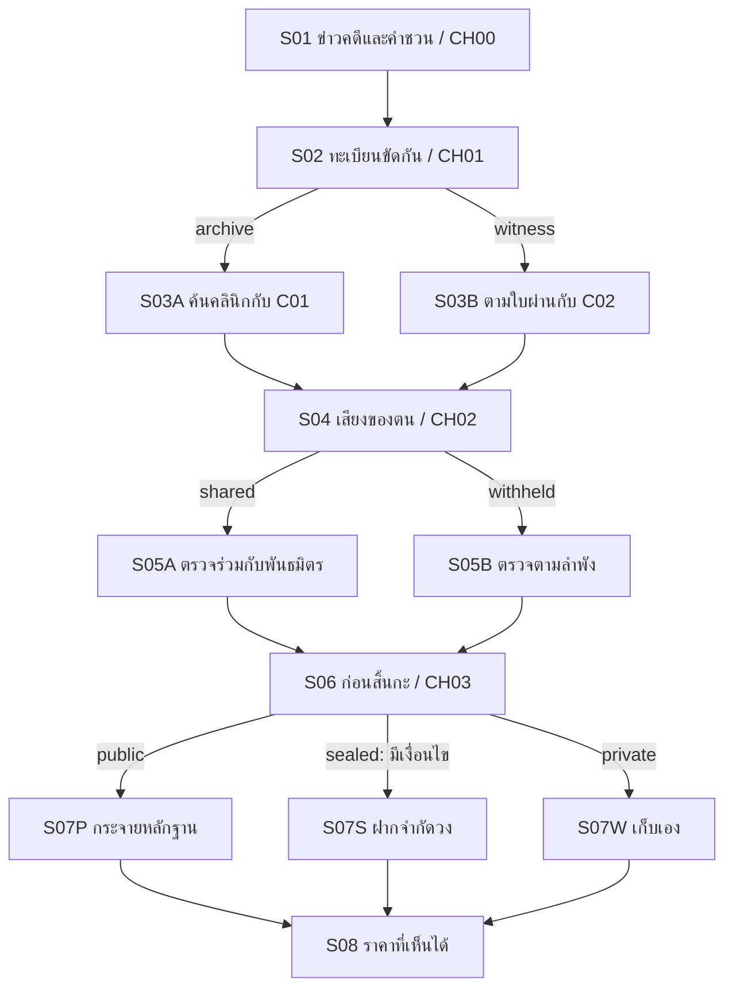

# 04 — Slice, branch และ state contract

**S0 / PROPOSED — เป็น specification บนกระดาษ ไม่มี runtime หรือบทเต็ม** Q04 เปลี่ยนจุดเริ่ม: C00 มีความรู้/ประสบการณ์ทดลองเดิม และถูกดึงกลับมาด้วยข่าวกับคำชวน; Q03 เลือกความรักช่วงกลางเกม จึงไม่ปรากฏใน slice เปิดเรื่อง; Q07 กำหนดตัวละครหลักเกมเต็มมากกว่า 7 คน. หากเปลี่ยนรายละเอียดเหล่านี้ ให้ปรับก่อนนำไปเขียนเกม.

## 1. ขอบเขตทดลอง

- หนึ่งเหตุการณ์ต้นบทแรก เป้าหมาย **25–40 นาทีต่อรอบ** ซึ่งต้องวัดกับบทจริง ไม่ใช่ estimate ยืนยัน
- 12 scene nodes; หนึ่งรอบผ่าน 8 nodes; 4 choices = CH00 utility + CH01/02/03 ที่เปลี่ยนเหตุการณ์/ความร่วมมือ/ผลลัพธ์
- 2 investigation routes, พันธมิตรประจำ route 1 คน, 3 checkpoint outcomes; ไม่ใช่ 3 ตอนจบเกมเต็ม
- ไม่มีต่อสู้, grind, real-time timer, randomness, free-text deduction หรือ live LLM ใน baseline เสนอ
- คงความสัมพันธ์ ทีม สถานะ และ Level ด้วยระบบเล็ก ไม่สร้างทุกตัวเลขใน brief

**เหตุการณ์ทดลอง:** ตัวเอกได้ข่าวคดีคนหายและคำชวนจากผู้เกี่ยวข้องกับการทดลองเดิม (ตัวผู้ชวนยัง PROPOSED) เอกสารอ้างอิงทำให้ความรู้เก่ากลับมามีความหมาย. ผู้เล่นเลือกสืบจากคลินิกหรือบันทึกอิสระ ก่อนสิ้นกะเลือกว่าจะกระจายหลักฐาน ฝากตรวจสอบจำกัดวง หรือเก็บไว้เอง. การเลือกตรวจ CH00 คือการกลับมาใช้ทักษะเดิม ไม่ใช่เพิ่งได้ความรู้; ยังไม่มี romance choice ในช่วงเปิดเรื่อง.

## 2. Scene graph

เส้นแบ่ง route และ checkpoint ใช้ scene คนละอัน ส่วน CH00 อยู่ใน S01 และไม่สร้าง node ใหม่

## 3. Scene contract ที่เตรียมไว้ให้ผู้เขียน

| Node | หน้าที่/เหตุการณ์ | เข้า → ออก / state ที่แตะ | ข้อมูลก่อน choice / ผลที่ต้องเห็น |
|---|---|---|---|
| S01 | พบข่าวคดีและได้รับคำชวนให้ช่วย; มีเอกสารอ้างอิง E01 | เริ่ม → S02; รับ E01; CH00 | ความรู้เดิมของ C00; inspect คือเลือกใช้ทักษะกับหลักฐาน ไม่ได้สร้างความรู้ใหม่ |
| S02 | ค้นคนเดียวกันแล้วไม่มีผล แต่ใบรับยังอยู่ | CH01 → S03A หรือ S03B | บอกชัดแต่ละผู้ช่วยเข้าถึงคนละแหล่ง และมีเวลาตามได้เส้นเดียวก่อนสิ้นกะ |
| S03A | C01 เปิดบันทึกคลินิกที่แยก “จำกัดสิทธิ์” จาก “ไม่มีข้อมูล”; เสี่ยงถูกตรวจงาน | เข้า archive → S04; รับ E02 | ผู้เล่นเห็นการช่วยของคนในและสิ่งที่เขายังเลี่ยงพูด |
| S03B | C02 พาเทียบใบผ่านขนส่ง พบ token ที่ยังใช้หลังเหตุ | เข้า witness → S04; รับ E03 | ได้เหตุการณ์นอกคลินิกและข้อจำกัดว่า token ไม่ยืนยันผู้ถือ |
| S04 | เปิดส่วนเสียงในแพ็กเกจเดิม; เสียงคล้ายตัวเอกที่จำไม่ได้ | รับ E04; CH02 → S05A/S05B | แยกความคล้ายเสียงจากการพิสูจน์ตัวตน; บอกว่าผู้ช่วยตรวจ/ฝากแทนได้หากเห็นแพ็กเกจ |
| S05A | ให้พันธมิตรดูเสียงและตรวจ provenance ร่วม | shared → S06 | พันธมิตรรู้ความเสี่ยงของตัวเอก เสนอช่วยฝาก; คนที่รู้เรื่องเพิ่มขึ้นจริง |
| S05B | ตัวเอกเก็บเสียงไว้ ตรวจเองได้เท่าที่เรียนมา | withheld → S06 | ยังมี E01–E04 ที่ได้จริง แต่พันธมิตรไม่รู้เสียงและไม่ช่วยรับรองสิ่งที่ไม่ได้เห็น |
| S06 | รู้กำหนดหมุนทิ้ง audit และทางเก็บแพ็กเกจ; ได้คำเตือน metadata | CH03 → S07P/S07S/S07W | แสดงผลแลกเปลี่ยนทั้งสาม; sealed เปิดเมื่ออ่านใบรับเป็นหรือมีผู้ช่วยร่วมตรวจ |
| S07P | เผยแพร่ฉบับตัดข้อมูลระบุตัวโดยตรง แต่เวลา/จุดกำเนิดยังตามรอยได้ | public → S08 | สำเนาแพร่ต่อ ควบคุมผู้รับไม่ได้; route กำหนดแหล่งที่เสี่ยงถูกตาม ไม่ใช่เปิดโปงผู้ร้ายได้ทันที |
| S07S | ฝากแพ็กเกจพร้อมแบบแหล่งกำเนิดครบแก่ผู้รับจำกัดวง | sealed → S08 | มีช่องทางตรวจซ้ำ แต่ต้องพึ่งผู้ถือครอง; ถ้าอ่านใบรับเป็นใช้ตนเอง ถ้าไม่เป็นใช้พันธมิตร |
| S07W | เก็บสำเนาเองและออกจากเหตุการณ์ก่อน audit หมุนทิ้ง | private → S08 | ไม่แพร่ metadata เพิ่ม แต่สูญเสียโอกาสตรวจต้นทางทันที; ไม่ลบเบาะแสที่เก็บแล้ว |
| S08 | เห็นผลแรกต่อแหล่งข้อมูลและคนที่ช่วย; ตั้งเป้าหมายสืบต่อ | checkpoint จบ slice | จ่าย payoff ของ route/disclosure/custody; ทิ้งคำถาม consent เป็น hook ไม่เฉลย T04 |

แต่ละ scene ตอนเขียน P07 ต้องเพิ่ม: POV, ใครอยู่/รู้เรื่องใด, objective, conflict, evidence source, input/output, asset IDs, text IDs, คำเตือนเนื้อหา และ payoff target ใช้ตารางนี้เป็นโครงที่เติม ไม่เริ่มไฟล์ spec อีกชุดที่ขัดกัน

## 4. Choice / edge table — กติกาอ้างอิงหลัก

`unset` เป็นค่าเริ่มต้นสำหรับสิ่งที่ยังไม่เลือก การกด history/journal ไม่ใช่การเลือกซ้ำ

| Choice / จุด | ตัวเลือกและเงื่อนไข | การเปลี่ยน state | Node ถัดไป |
|---|---|---|---|
| CH00 / S01 | `inspect`: ตรวจเลขรับส่งและวิธีระบุแหล่ง | receipt_checked = true | S02 |
| CH00 / S01 | `skip`: เก็บใบรับไว้ก่อน | receipt_checked = false; E01 ยังได้ | S02 |
| CH01 / S02 | `archive`: ไปกับ C01 | lead = archive | S03A |
| CH01 / S02 | `witness`: ไปกับ C02 | lead = witness | S03B |
| CH02 / S04 | `share`: ให้พันธมิตรฟังเสียงของตนและตรวจด้วย | disclosure = shared | S05A |
| CH02 / S04 | `hold`: เก็บเสียงไว้ก่อน | disclosure = withheld | S05B |
| CH03 / S06 | `publish`: เปิดเผยฉบับตัดข้อมูลโดยตรง; ทำได้เสมอ | custody = public | S07P |
| CH03 / S06 | `seal`: ฝากให้ตรวจจำกัดวง; Level ≥ 1 **หรือ** disclosure = shared | custody = sealed | S07S |
| CH03 / S06 | `withdraw`: เก็บเอง; ทำได้เสมอ | custody = private | S07W |

ไม่มี edge อื่น การกลับไปเลือกอีก route ทำผ่าน rollback/load ซึ่งต้องย้อน state ทั้งชุด ไม่ใช่สะสม E02+E03 ข้ามเส้น ทาง sealed ที่ปิดแสดงเหตุผลว่าแบบระบุแหล่งยังไม่ครบและผู้ช่วยยังไม่เห็นแพ็กเกจ; สื่อวิธีเตรียมไว้ตั้งแต่ S01/S04 ไม่ซ่อนเงื่อนไขจนถึงวินาทีสุดท้าย

**Trade-off ที่ต้องรักษา:** inspect เป็นตัวเลือกเรียนรู้/utility ไม่ต้องฝืนให้เป็น dilemma ใหญ่; CH01 เลือกแหล่งกับความเสี่ยงคนละแบบ; CH02 ได้ความร่วมมือแลกกับการเผยความเปราะบาง/คนที่รู้เพิ่ม; CH03 เลือกการควบคุมข้อมูลกับความเร็วในการรักษาร่องรอย ไม่มีตัวเลือก “ถูก” ที่ให้ทุกอย่างฟรี

## 5. State dictionary

| Field | Type / default | เขียนที่ใด | อ่านที่ใด / ขอบเขต |
|---|---|---|---|
| scene_id | scene enum / S01 | transition ตาม graph | runtime position, restore; ต่อ save |
| evidence | set ของ E01–E04 / ว่างก่อนเข้า S01 | S01 เพิ่ม E01; S03A เพิ่ม E02 หรือ S03B เพิ่ม E03; S04 เพิ่ม E04 | journal, dialogue, evidence tests; ต่อ save |
| receipt_checked | boolean / false | CH00 เท่านั้น | Level, sealed eligibility, S07S; ต่อ save |
| lead | enum unset/archive/witness / unset | CH01 | ally, scene variants, S08; ต่อ save |
| disclosure | enum unset/shared/withheld / unset | CH02 | collaboration, knowledge, sealed eligibility; ต่อ save |
| custody | enum unset/public/sealed/private / unset | CH03 | checkpoint/world consequence; ต่อ save |
| choice_log | ลำดับ choice ID + option / ว่าง | commit choice แต่ละจุดครั้งเดียวใน timeline นั้น | debug causal trace, idempotency; ย้อนตาม save/rollback |
| content_revision | metadata / S0.v0.1 | เมื่อสร้าง save โดย runtime ในอนาคต | ตรวจความเข้ากันได้ของเนื้อหา; ไม่ใช้ตัดสินเรื่อง |

### ค่าที่คำนวณจาก state ไม่เก็บซ้ำ

| ชื่อ | นิยาม | เหตุผลที่มีผลจริง |
|---|---|---|
| investigation_level | 1 เมื่อ receipt_checked=true มิฉะนั้น 0 | เปิด seal ได้ด้วยตนเอง เป็น milestone ความสามารถ ไม่ farm XP |
| ally | C01 เมื่อ archive; C02 เมื่อ witness | เปลี่ยนคน/เหตุการณ์/แหล่งหลักฐาน และวิธีช่วย |
| collaboration | cooperating เมื่อ shared; guarded เมื่อ withheld | ผู้ช่วยช่วยรับรองได้เฉพาะข้อมูลที่เห็น; S05A/S05B ต่างกัน |
| can_seal | investigation_level ≥ 1 หรือ disclosure=shared | ทางช่วยเหลือชดเชยทักษะได้; ไม่ทำให้ผู้ข้าม tutorial ตัน |
| source_exposure | custody=public แล้วผูกกับ lead | archive เสี่ยงตำแหน่งคนใน; witness เสี่ยงทางเดินทาง/ผู้ให้ข้อมูล |
| event_phase | จาก scene order | เวลาอ่านไม่ทำให้ deadline ขยับ |

**Trust/Bond/Suspicion:** ความต้องการความสัมพันธ์ยังอยู่ แต่ไม่ต้องมีทั้งสามตัวเลขใน slice ใช้ collaboration กับประวัติการกระทำก่อน เมื่อ full scene จำเป็นต้องแยก “รักแต่ไม่ไว้ใจ” หรือ “ไว้ใจความสามารถแต่กลัวผลประโยชน์” จึงเพิ่มมิติพร้อม write/read/payoff ที่แยกได้ **World State** ตอนนี้ใช้ custody + exposure; **Team** คือ ally; **Level** ใช้ investigation_level ชัดเจน

## 6. Invariants และการ restore

1. S01 ให้ E01 เสมอ; skip ไม่ทำให้ไม่มีหลักฐานตั้งต้น
2. ตั้งแต่ S04 เป็นต้นไปต้องมี E02 หรือ E03 **อย่างใดอย่างหนึ่งเท่านั้น** ตาม lead; ถึงหลังเข้า S04 มี E04
3. ที่ S06 lead/disclosure ต้องไม่ unset; ที่ S08 custody ต้องไม่ unset
4. sealed เป็นไปได้เมื่อ can_seal=true เท่านั้น แต่ publish/withdraw มีเสมอ
5. การรับหลักฐานเป็น set addition; การเข้า scene ใหม่ไม่เพิ่ม Level หรือ relation แบบสะสมซ้ำ
6. choice_log มี CH00/01/02/03 อย่างละหนึ่งรายการเมื่อถึง S08; rollback ตัดเหตุการณ์หลังจุดย้อน ไม่ทิ้ง “เคยทำในอนาคต” ใน story state
7. Journal แสดงเฉพาะข้อมูลใน save นี้ ระบุ “พบ”, “สงสัย”, “ยืนยันจากแหล่งใด” แยกกัน; author truth T01–T07 ไม่ถูกเปิดให้ผู้เล่นอัตโนมัติ
8. ตั้งแต่ CH03 เป็นต้นไปการหมุนทิ้งต้นทางเป็น event ที่ทราบแล้ว ไม่ลบ evidence set ที่เคยได้; ผลต่างคือความสามารถตรวจซ้ำและผู้ถือข้อมูล
9. โหลด/rollback แล้วได้ scene, evidence, choices และ eligibility เดิม; settings เช่น text speed แยกจาก story state และไม่ให้ผลกับ ending
10. revision ที่ไม่รองรับต้องแจ้งและคงไฟล์เดิมไว้; ไม่แอบ reset flags หรืออ่าน save เป็นเหตุการณ์ที่ขัด canon; นโยบาย migration ตัดสินก่อนเผยแพร่ build ที่ต้องรักษา saves

## 7. ผล checkpoint ที่ต้องต่างให้เห็น

| Custody | ผลทันที | ผล route ที่ต้องคงหลัง merge | ผล disclosure / ทางสืบต่อ |
|---|---|---|---|
| public | แพ็กเกจกระจาย มีคนรับรู้ข้อขัดแย้ง แต่ยังไม่ทราบผู้สั่งการ | archive: คนในถูกถามเรื่องการเข้าถึง; witness: ช่องทางเดินทางเสี่ยงถูกตาม | shared: พันธมิตรร่วมเตรียมรับผล; withheld: ไม่รู้ที่มาเสียงและขอคำอธิบาย; สืบ E05 ต่อได้ |
| sealed | มีผู้รับฝากจำกัดวงและ manifest สำหรับตรวจซ้ำ; ไม่มีชื่อผู้ร้ายปรากฏฟรี | แหล่งที่ฝากต่างกันตาม lead และระบุ provenance ไว้ | Level=1 ทำแบบได้เอง; Level=0 ต้องร่วมกับ ally; ถ้าทั้งสองมี ใช้วิธีทำเองแล้วให้ ally ตรวจ ไม่สุ่มเลือก |
| private | เก็บเบาะแสไว้เอง; พลาดหน้าต่างตรวจ audit ต้นทาง แต่ยังเดินเรื่องต่อ | เริ่มบทต่อไปด้วยคำขอสำเนา E05 หรือพบพยานตาม lead คนละช่องทาง | shared ยังมีคนรู้และช่วยได้; withheld ต้องเริ่มสร้างความร่วมมือใหม่; ไม่มี instant bad end |

ไม่รับรองว่าคนที่ public จะตาย หรือ sealed จะปลอดภัยตลอดไป ต้องสร้างเหตุการณ์ถัดไปตามข้อมูลและความสามารถฝ่ายตรงข้ามที่มีจริง ไม่ใช้ choice เดียวเป็นคำตัดสินทั้งชีวิตโดยไม่มี warning

## 8. จำนวนเส้นทางที่ตรวจได้

ก่อน CH03 มี 2(receipt) × 2(lead) × 2(disclosure) = **8 state classes**

| receipt_checked | disclosure | can_seal | choices ที่ CH03 | trace รวมสอง lead |
|---|---|---|---|---|
| false | withheld | false | publish, withdraw | 4 |
| false | shared | true | publish, seal, withdraw | 6 |
| true | withheld | true | publish, seal, withdraw | 6 |
| true | shared | true | publish, seal, withdraw | 6 |

รวม **22 terminal traces** ใน S0 ไม่มี RNG หรือ choice อื่นที่ไม่อยู่ในตารางนี้ นับเส้นทางการเล่น ไม่ใช่ 22 บทจบที่ต้องเขียนใหม่ ทั้งหมดต้องทดสอบเมื่อมี runtime; ตอนนี้นับและตรวจได้เฉพาะแบบจำลองเอกสาร

### Inline variant families ที่ต้องรวมในต้นทุน

| Variant | จุดที่ใช้ | แกนที่ทำให้ข้อความ/ผลต่าง |
|---|---|---|
| V01 | S04 | lead → ใช้ E02 หรือ E03 ตีความเสียงต่างกัน |
| V02 | S05A | ally → วิธีร่วมตรวจและสิ่งที่ยอมเปิดเผย |
| V03 | S05B | receipt_checked → อ่านแบบเองเป็น/ยังไม่เป็น |
| V04 | S06 | can_seal → ตัวเลือก/คำอธิบายข้อจำกัด |
| V05 | S07P | lead → ใคร/แหล่งใดเสี่ยงตามรอย |
| V06 | S07P | disclosure → พันธมิตรพร้อมรับผลหรือขอคำอธิบาย |
| V07 | S07S | receipt_checked → provenance ผ่านตนหรือ ally |
| V08 | S08 | lead, disclosure, custody → สรุปผลและ hook โดยใช้บล็อกที่ประกอบกันได้ |

8 families ไม่ใช่ 8 บรรทัดและไม่ใช่ฉากฟรี ต้องนับปริมาณข้อความแต่ละค่าและชุดที่โต้ตอบกันจริงก่อนประเมินเวลาเขียน ตรวจรายละเอียด coverage ใน [06](06_VALIDATION_AND_RISKS.md)
